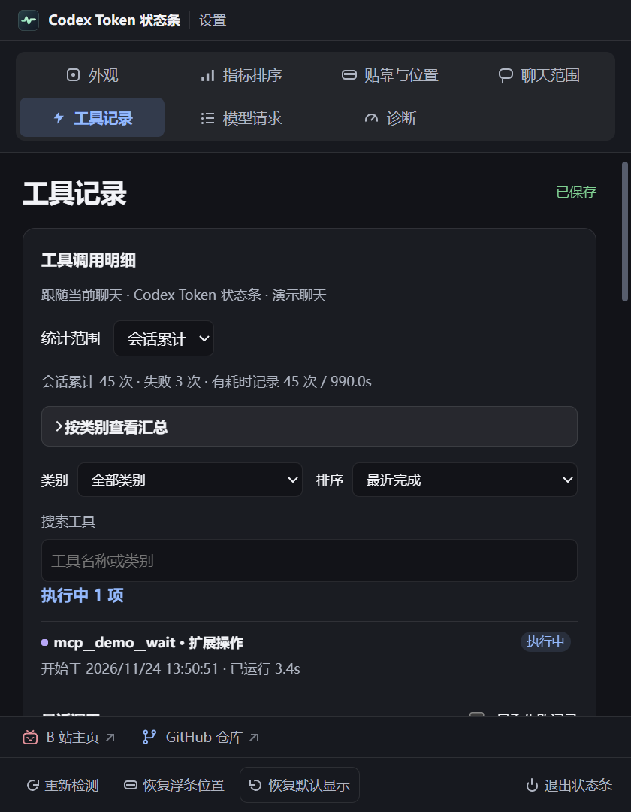

# Codex Token 状态条

跟随 Codex 桌面窗口的 Windows 浮条，显示 Token 用量、上下文和账号额度。

**[下载 Windows x64 安装包](https://github.com/3ALLBUY14/codex-token-statusbar/releases/latest)**

## 怎么用

1. 完整解压安装包，双击 **安装.cmd**，点击「安装并启动」。便携使用可直接运行 app 目录里的 **CodexTokenStatusbar.exe**。
2. 打开 Codex 桌面版并进入聊天。点击浮条的 **C** 展开或收起明细，点击 **⚙** 打开设置。

## 界面介绍

### 浮条

默认显示在 Codex 窗口右上方。首 Token 延迟、缓存率、工具次数等指标可在「指标排序」里启用。

### 明细面板

| 分页 | 可以查看什么 |
| --- | --- |
| **总览** | 会话累计、轮次均速、首 Token 延迟、上下文构成、工具统计和官方额度。 |
| **用量** | 当前聊天或全部本地聊天的用量趋势、模型排行和热力图，可切换 7 天、30 天或近一年。 |
| **模型** | 分别查看当前模型与历史模型的 Token、缓存、推理用量和请求数。 |
| **请求** | 按轮次浏览每次模型请求，查看 Token、缓存率、首 Token 延迟和耗时，支持按模型筛选。 |

额度卡显示已用、剩余和重置时间，每 5 分钟自动刷新，也可点击右上角 **↻**。ChatGPT Pro 只显示周额度。

查看总览、用量、模型和请求截图

以下截图使用演示数据。

**总览**

**用量**

**模型**

**请求**

### 设置

| 设置页 | 可以做什么 |
| --- | --- |
| **外观** | 预览浮条，调整主题、缩放和不透明度，也可隐藏指标文字。 |
| **指标排序** | 勾选要显示的指标，拖动或按上下按钮调整顺序。 |
| **贴靠与位置** | 自由拖动，或贴靠在标题栏、输入框附近，支持居中、靠左和靠右。 |
| **聊天范围** | 自动跟随当前聊天，或搜索并锁定一个聊天。 |
| **工具记录** | 查看工具状态、耗时和失败记录，支持搜索、筛选和排序。 |
| **模型请求** | 按模型和日期筛选逐请求明细。 |
| **诊断** | 查看连接和窗口跟随状态、检查版本，并设置新版提醒。 |

查看设置和工具记录截图

