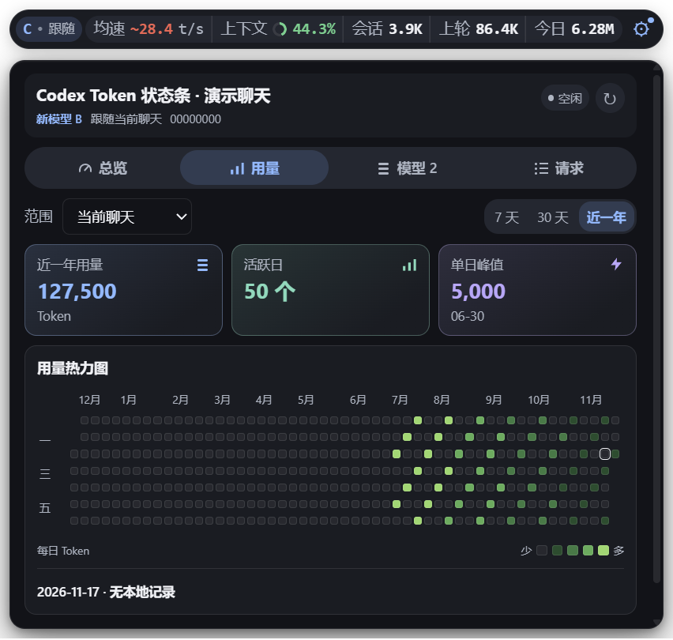
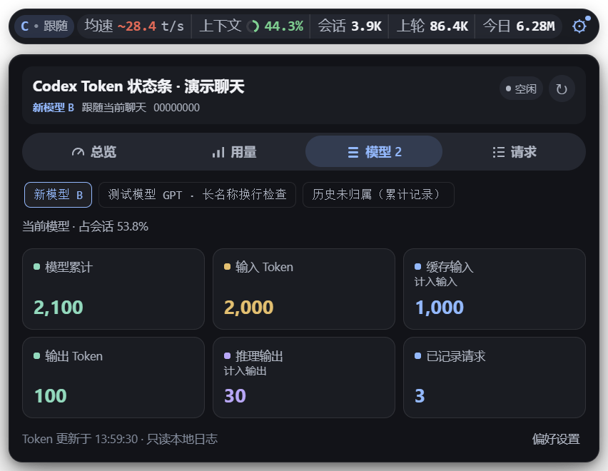

<h1 align="center">Codex Token 状态条</h1>

跟随 Codex 桌面窗口，查看用量、上下文和账号额度。

  <strong><a href="https://github.com/3ALLBUY14/codex-token-statusbar/releases/latest">下载 Windows x64</a></strong>
  &nbsp;·&nbsp; <a href="#快速开始">快速开始</a>
  &nbsp;·&nbsp; <a href="#界面指南">界面指南</a>

## 快速开始

1. 解压安装包，双击 **安装.cmd**，点击「安装并启动」。
2. 打开 Codex 桌面版并进入聊天，浮条会出现在窗口上。

便携使用可直接运行 app 目录里的 **CodexTokenStatusbar.exe**。

## 界面指南

### 浮条

默认在 Codex 窗口右上方，随聊天更新用量。点击 <kbd>C</kbd> 展开或收起明细，点击 <kbd>⚙</kbd> 打开设置。

### 明细面板

- **总览**　轮次均速、首 Token 延迟、会话累计、上下文构成、工具统计和额度。
- **用量**　查看当前聊天或全部本地聊天的趋势、模型排行和热力图，支持 7 天、30 天和近一年。
- **模型**　对比不同模型的 Token、缓存、推理用量和请求数。
- **请求**　按轮次查看每次模型请求的 Token、缓存率、首 Token 延迟和耗时，可按模型筛选。

官方额度显示已用、剩余和重置时间，每 5 分钟自动刷新，也可点击 **↻**。ChatGPT Pro 只显示周额度。

<strong>查看明细面板截图</strong>

总览 · 点击图片查看原图

  
  &emsp;
  

用量趋势 · 热力图

  
  &emsp;
  

模型用量 · 请求明细

### 设置

#### 外观与位置

- **外观**　预览浮条，调整主题、缩放和不透明度，可隐藏指标文字。
- **指标排序**　勾选显示项，通过拖动或上下按钮排序。
- **贴靠与位置**　自由拖动浮条，或贴靠标题栏、输入框附近，可选居中、靠左或靠右。

#### 用量与诊断

- **聊天范围**　自动跟随当前聊天，或搜索并锁定一个聊天。
- **工具记录**　搜索和筛选工具调用，查看运行状态、耗时和失败记录。
- **模型请求**　按模型与日期筛选逐请求明细。
- **诊断**　查看连接和窗口跟随状态，检查版本或开启新版提醒。

<strong>查看外观和工具记录截图</strong>

  
  &emsp;
  

浮条外观 · 工具记录

