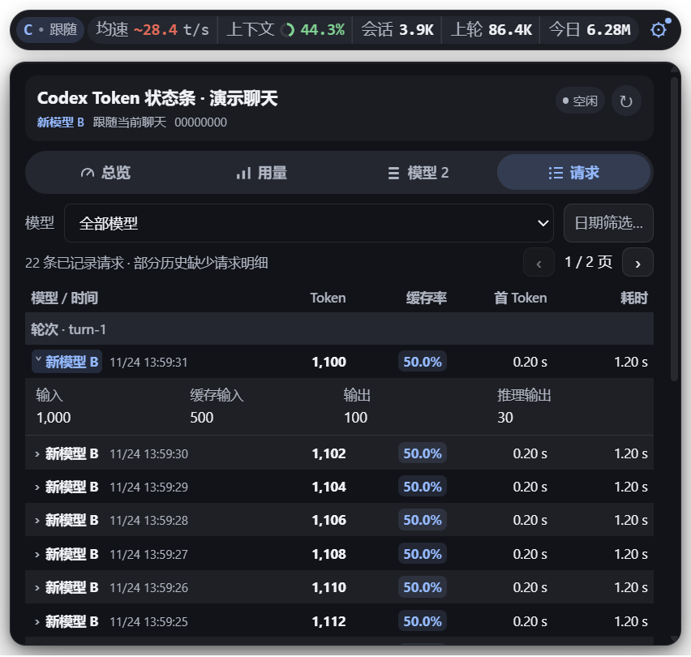

<h1 align="center">Codex Token 状态条</h1>

在 Codex 桌面窗口上查看 Token 用量、上下文和账号额度。

  <strong><a href="https://github.com/3ALLBUY14/codex-token-statusbar/releases/latest">下载 Windows x64</a></strong>
  &nbsp;·&nbsp; <a href="#安装与使用">安装与使用</a>
  &nbsp;·&nbsp; <a href="#界面预览">界面预览</a>

## 安装与使用

1. **安装版**　完整解压安装包，双击 **安装.cmd**，点击「安装并启动」。
2. **开始使用**　打开 Codex 桌面版并进入聊天。点击浮条的 <kbd>C</kbd> 展开明细，点击 <kbd>⚙</kbd> 打开设置。

便携使用可在解压后直接运行 app 目录里的 **CodexTokenStatusbar.exe**。

## 功能

- **跟随当前聊天**　浮条默认在 Codex 窗口右上方，显示轮次均速、上下文占用和 Token 用量。可自由拖动，或贴靠标题栏、输入框附近。
- **查看上下文与额度**　上下文按 Token 构成分段。官方额度显示已用、剩余和重置时间，每 5 分钟自动刷新，也可在总览点 **↻**。ChatGPT Pro 只显示周额度。
- **回顾用量**　查看当前聊天或全部本地聊天的趋势和热力图，还可按模型统计用量、按轮次浏览请求。
- **调整浮条**　可更改主题、缩放、透明度和指标顺序，也能隐藏指标文字或锁定聊天。

## 界面预览

截图使用演示数据，点击可查看原图。

<strong>明细面板</strong> · 总览、用量、模型、请求

| 分页 | 查看内容 |
| --- | --- |
| **总览** | 轮次均速、首 Token 延迟、会话累计、上下文构成、工具统计和额度。 |
| **用量** | 模型用量排行和每日趋势，支持 7 天、30 天和近一年。 |
| **模型** | 各模型的 Token、缓存、推理用量和请求数。 |
| **请求** | 按轮次查看单次请求的 Token、缓存率、首 Token 延迟和耗时，可按模型筛选。 |

总览

  
  &emsp;
  

用量趋势 · 热力图

  
  &emsp;
  

模型用量 · 请求明细

<strong>设置窗口</strong> · 外观、贴靠、工具记录等

| 页面 | 操作 |
| --- | --- |
| **外观** | 实时预览浮条，调整主题、缩放和不透明度，或隐藏指标文字。 |
| **指标排序** | 勾选显示项，拖动或使用上下按钮排序。 |
| **贴靠与位置** | 选择贴靠区域，可设置居中、靠左或靠右。 |
| **聊天范围** | 自动跟随当前聊天，或搜索并锁定一个聊天。 |
| **工具记录** | 搜索和筛选工具调用，查看运行状态、耗时和失败记录。 |
| **模型请求** | 按模型与日期筛选逐请求明细。 |
| **诊断** | 查看窗口跟随和连接状态，检查版本并选择新版提醒方式。 |

  
  &emsp;
  

浮条外观 · 工具记录

