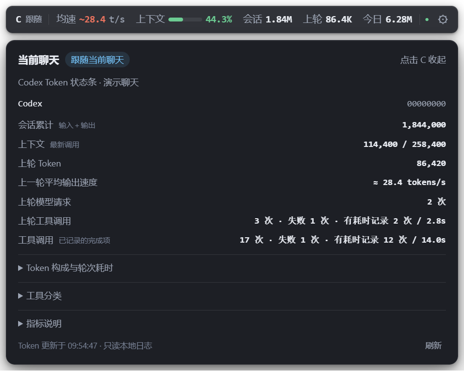
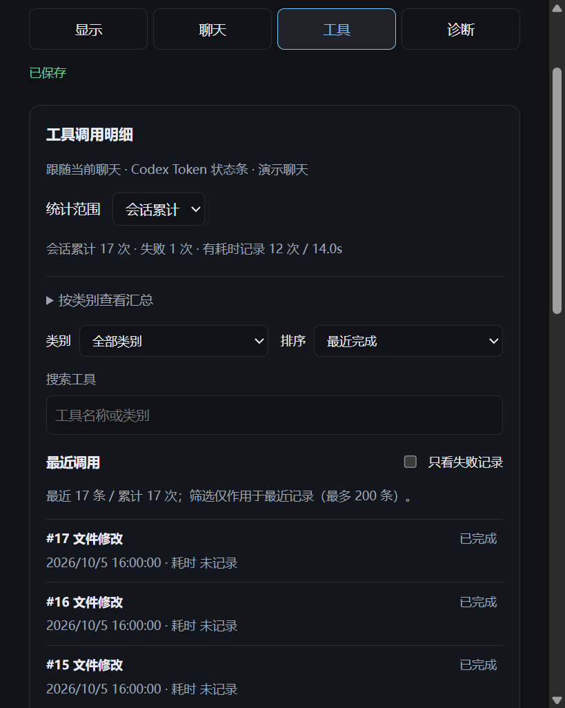

# Codex Token 状态条 V1.9（Windows）

为 Codex 桌面版提供一个跟随窗口的独立浮条。基于
[zcode-token-usage-statusbar](https://github.com/xhwxt/zcode-token-usage-statusbar)
的胶囊、进度条和明细面板样式适配，读取本机 Codex 日志。


<details>
<summary>查看明细面板（模拟数据）</summary>



</details>

## 开始使用

从 [GitHub Releases](https://github.com/3ALLBUY14/codex-token-statusbar/releases/latest) 下载 `CodexTokenStatusbar-V1.9-Windows-x64.zip`。

安装版：解压整个压缩包，双击 **`安装.cmd`**，选择是否开机启动和创建桌面入口，再点击“安装并启动”。安装到当前用户目录，无需管理员权限。可在 Windows“设置 → 应用”中卸载。

便携版：双击安装包 `app` 目录中的 **`CodexTokenStatusbar.exe`**。
无需额外安装 Node.js 或 Python；窗口助手使用 Windows 自带的 .NET Framework 4.x。

1. 打开 Codex 桌面版，进入一个有模型响应记录的聊天。
2. 浮条默认出现在窗口右上方；切换到其他应用时自动隐藏。
   使用 Seelen UI 等第三方桌面时，默认启用“兼容第三方桌面（加强置顶）”，自动恢复窗口层级且不抢键盘焦点。需要在其他应用中保留浮条时，另行勾选“切换到其他应用时仍显示”。
   在“设置 → 显示 → 位置与拖动”中勾选“贴靠 Codex 窗口”，再选择区域。“标题栏内”占用菜单和窗口按钮之间的空白区域，自动缩小以适应高度，明细向下展开；“输入框附近”优先放在下方，空间不足时放在上方。旧版本的输入框区域选择会保留。
   可在“贴靠对齐”中选择“自适应居中”（默认）、“靠左”或“靠右”，以所选区域为基准，随宽度变化自动调整；展开或收起明细时也保持浮条对齐。区域和对齐选择自动保存，关闭贴靠不丢失选择。
   贴靠模式暂停自由拖动与位置偏移；关闭后恢复原浮动位置。区域未识别、数据过期或切换应用时隐藏，不沿用其他页面的位置；全屏隐藏了菜单或窗口按钮时，标题栏贴靠会隐藏。“恢复浮条位置”也可退出贴靠模式。
   窗口贴靠仍是独立浮层，不会向 Codex 注入代码或修改安装文件，也不为 Codex 布局挤出额外空间。当前版本未实现 Codex 原生内嵌；Codex 更新导致无障碍结构变化时，可能需要重新适配。默认浮动模式与聊天识别不受贴靠区域识别失败影响。
3. 鼠标进入浮条时自动半透明避让，移开后恢复；点击左侧 **C / 跟随** 展开明细，再点 C 收起。悬停与移开均不改变明细状态。
4. 点击 **⚙** 调整显示项、主题、大小、位置，或者锁定一个聊天。勾选“允许自由拖动浮条”后，拖动指标或空白处移动浮条，松开后保存位置；C 和设置按钮保持可点击。
5. 托盘图标右键可以刷新、显示/隐藏、设置或退出。托盘图标可能在 `^` 内。
6. 设置中的“隐藏浮条文字”可隐藏指标名称和跟随状态，保留数值、进度条及操作按钮；明细文字仍完整显示。
7. 浮条找不到时，重新启动桌面入口，并在设置或托盘菜单中点击“恢复浮条位置”。
8. 设置页的“运行诊断”显示聊天连接、窗口跟随、浮条可见性和日志读取状态，便于定位升级后浮条不出现的问题。
9. 窄窗口或高缩放下，收起的指标数量显示在 C 按钮中，如 `C +3`；点击整个 C 按钮查看明细。累计、上下文、轮次、速度和工具次数在摘要中展示，今日与缓存等额外指标按需补充，避免重复列出。窗口跟随助手每两秒报告一次状态，设置页显示最后响应时间，超时后自动重启。
10. 默认按 Codex 所在显示器分别记住位置，支持把浮条拖到另一显示器；目标屏幕断开后回到可用屏幕。可以关闭位置记忆；“恢复浮条位置”清除全部显示器位置记忆。
11. 设置 → 显示 → 外观中可调整“浮条不透明度”（20%–100%）。拖动实时预览、松开保存；Esc 取消未提交预览，关闭或重新加载设置也会取消预览。仅影响浮条，明细和设置保持清晰；鼠标进入浮条时最多显示为 45% 不透明度，较低值保持原样。恢复默认显示会恢复到 100%，可撤销。
12. 设置页签下方显示“正在保存 / 已保存”；保存失败时保留原因并可点击“重试保存”。恢复位置也有同样的反馈。显示页分为外观与位置，数值偏移位于“高级位置设置”。

安装时可以选择登录 Windows 自动启动，也可重新安装取消该选项。更新安装版会保留显示偏好和快捷方式选项；安装器先校验暂存副本，再替换旧版，安装失败时恢复旧版。旧便携版需要先从托盘退出。偏好设置保存在
`%APPDATA%\CodexTokenStatusbar\settings.json`，需要彻底清除时可自行删除该目录。

## 指标

| 指标 | 口径 |
| --- | --- |
| 会话 Token | 当前聊天的累计输入＋输出；缓存输入属于输入，推理输出属于输出，均不重复累加 |
| 本轮 / 上轮 Token | 当前轮次或最近已完成轮次的累计用量变化；可能含多次模型调用 |
| 上下文 | 最新 `last_token_usage.total_tokens` / `model_context_window`，随新日志更新；不是会话累计 Token |
| 平均输出速度 | 最近已完成轮次的输出 Token /（`duration_ms` − `time_to_first_token_ms`），单位 tokens/s |
| 缓存命中率 | 会话累计缓存输入 / 会话累计输入 |
| 今日 Token | 本机日历日期内，各聊天日志累计用量的正向增量；所有已发现本地聊天均纳入，不限当前聊天 |
| 工具调用 | 当前聊天日志中已完成的命令执行、文件修改、扩展操作和图像查看次数；失败数按结构化状态统计，有耗时记录的项目合计耗时 |

点击 C 的明细还显示本轮或上一轮的模型请求数，以及该轮工具调用次数、失败数、可用耗时和按类别分组。会话工具累计与轮次工具统计分别展示。

明细默认展示摘要；“Token 构成与轮次耗时”“工具分类”和“指标说明”可分别点击展开。刷新数据会保留已展开的二级内容，切换聊天后恢复折叠；外层明细始终由 C 控制开合。

设置分为 **显示 / 聊天 / 工具 / 诊断** 四栏，支持键盘左右方向键切换。聊天栏可按标题、模型或 ID 搜索全部已发现的根聊天，每页 20 项；锁定项始终保留在选择器中。“恢复默认显示”保留聊天锁定、上下文容量、位置与拖动设置，并提供撤销。

设置 → **工具** 可切换会话累计与本轮/上一轮，查看分类汇总及最近 200 条已完成调用的类别、完成时间、状态、退出码和已记录耗时，每页 20 条。支持工具名称搜索、类别筛选、只看失败、按耗时排序，以及执行中状态。具体工具名和开始状态仅在本地日志提供相应元数据时显示。隐藏浮条文字或关闭工具指标时，设置明细仍可查看。记录不包含命令参数、文件内容或工具输出；缺失耗时显示“未记录”，历史汇总不受记录条数限制。

工具页直接展示搜索、筛选和记录；分类表位于“按类别查看汇总”，需要时展开，不再折叠整个记录区域。

诊断栏可一键复制不含聊天标题、ID、用户路径和调用正文的状态摘要，并主动检查 GitHub 最新发布或打开下载页。

<details>
<summary>查看设置里的工具调用明细（模拟数据）</summary>



</details>

上下文进度根据窗口容量提示：小于 100 万 Token 的窗口从 70% 显示黄色、85% 显示红色；100 万及以上窗口从 40% 显示黄色、60% 显示红色。明细会说明预警，只有日志明确报告上下文超限时才显示“超限”。这些阈值是提前提醒，不代表模型此时必然无法继续。

工具耗时只累计日志提供耗时的项目；明细会同时列出有耗时记录的次数。无该字段的调用仍计入总次数，不补估耗时。统计只读取结构化的项目类别、状态和时长，不保存调用参数或结果正文。

**平均输出速度不等于纯模型解码速度。**它包含推理输出、工具执行、等待和多次
模型请求的时间；标记为 `均速 ~xx.x t/s`。缺少首 Token 时间时使用整轮耗时；
缺少输出 Token 或有效耗时时显示 `—`。运行新一轮时保留上轮速度，活动点呈蓝色。
中断、失败或计数回退后不显示旧速度。
续接日志带入历史累计用量时，从首条请求用量推算初始基线，并在明细中标记估算；
缺少可用基线时不显示首轮速度。历史累计也不会整笔计入今日新增用量。

统计反映本地日志，不是账单或套餐额度。今日按 Windows 的当前本地日期归属；旧日志缺失、删除日志、不同电脑的聊天以及没有保存日志的调用无法重建。
计数回退、超大记录、读取错误或初始索引未完成时，今日值会标为 `≈`。

## 当前聊天如何识别

- 根据 Codex 主窗口所属进程，读取该进程的本地桌面日志中的 `ownerRoutePath` 页面切换记录；约每 250 毫秒检查增量记录，切换已缓存的旧聊天也不依赖新消息或 Token 更新。
- 页面路径缺失或停留在旧聊天时，以 Windows UI Automation 读取前台 Codex 窗口的文档标题，每约 750 毫秒检查一次；与本机 `session_index.jsonl` 中的标题精确匹配，唯一匹配时跟随该聊天。路径与标题相符时优先使用聊天 ID；不同结果会结合更新时间处理。
- 连接本机 `\\.\pipe\codex-ipc` 监测连接与消息流订阅。一个窗口可同时订阅多个后台聊天，因此订阅顺序不再用作当前页面的判断依据。
- 按聊天 ID 选择对应日志，包括切换到没有正在运行的旧聊天。
- 新聊天没有日志或用量时显示 `—`，不沿用上一聊天的数据。
- 路径与标题都无法识别时明确标记为 **最近**，显示最近活跃的桌面聊天；可在设置中手动锁定。已识别为首页、新聊天或尚未进入索引的聊天时清空聊天指标，显示“暂无”，不会沿用上一聊天的数据。
- 多个窗口的路径无法可靠对应到前台 HWND 时，尝试前台文档标题；标题重名且无可靠 ID 时显示 **待选**，请在设置中手动锁定聊天。
- 同名标题仅在路径晚于标题变更、且最近 60 秒内有页面路径确认时使用该 ID；其他情况提示选择，避免把旧路径当成当前聊天。诊断栏会显示页面 ID、唯一标题匹配、手动确认或身份不确定。
- 明细显示已选聊天的标题；设置中的运行诊断显示识别方式，便于确认正在使用路径、标题或手动锁定。
- 标题索引暂不可读时保留已有标题和已确认的当前聊天；不使用过期索引猜测新切换的聊天。新聊天需页面路径确认或手动锁定，恢复读取后自动恢复标题识别。诊断栏区分索引缺失、读取受限与超过上限。
- 兼容独立 `Codex.exe` 和当前 `OpenAI.Codex` 安装包内的 `ChatGPT.exe`。

桌面日志、IPC 与 JSONL 格式是版本敏感的内部接口，桌面客户端升级可能需要更新适配。
本版针对 Windows 10/11 x64，已验证 Codex Desktop 26.930.2377.0 的本机连接、当前聊天识别和窗口识别；未验证 Windows ARM64、macOS 或 Linux。

## 本地数据与权限

读取 `CODEX_HOME` 指定目录，默认 `~/.codex` 下的 `sessions/**/*.jsonl` 和
`archived_sessions/**/*.jsonl`。只提取用量、时间、模型、工具状态和聊天元数据；不读取 `auth.json`，
不写入 Codex 日志，不持久化聊天正文。没有遥测、模型请求或后台更新请求；仅在用户点击“检查更新”时访问固定的 GitHub Releases API，不携带聊天或账号数据。点击“打开下载页”会调用系统浏览器。
另外只读本机 `Codex/Logs` 或 MSIX 包的 `LocalCache/Local/Codex/Logs` 下的桌面日志，仅提取当前进程的页面路径、窗口标识和时间；不复制或保存桌面日志正文。读取 `session_index.jsonl` 中的聊天 ID 和标题，并通过 Windows UI Automation 读取前台 Codex 窗口的文档标题，用于本机识别和展示。
聊天 ID 仅用于本机绑定和选择；偏好设置可保存用户主动锁定的聊天 ID。

浮条是独立窗口；原项目的 ZCode 安装器和注入 loader 不会执行。

目录或日志暂不可读时保留已缓存统计、显示异常并标记今日统计暂不完整；确认文件删除后才移除对应数据。日志变化优先刷新相关文件，定期补扫；隐藏或后台时降低轮询频率，工具记录仅在设置需要时传送。

已完整读取且没有进行中轮次的历史日志会保存本地统计缓存，位于 `%APPDATA%\CodexTokenStatusbar\statistics-cache.json`。缓存仅含相对文件标识、文件校验信息、聊天 ID、模型、用量、时间和结构化工具状态，不保存聊天正文、命令参数或工具输出。仅复用文件标识、大小、修改时间和首尾摘要均一致的统计；变化的文件重新解析。缓存损坏、版本不兼容或不可写时直接读取日志，不影响原日志。可删除该缓存文件来重建。缓存不进入发布包，也不包含在复制诊断中；诊断只显示复用数量与错误状态。

Windows 窗口跟随默认通过随包的独立 Windows 助手实现，不弹控制台窗口。窗口坐标和标题识别分属两个进程；标题读取超时只重启标题通道，窗口跟随和页面 ID 识别继续工作。诊断栏分别显示助手类型、窗口心跳和标题通道状态。
独立助手缺失或连续三次启动失败时自动使用 PowerShell 兼容助手。若企业策略同时限制两种助手，可在设置中启用“切换到其他应用时仍显示”作为固定桌面浮条。

分享包只保留 Chromium 的简体中文与英文语言资源，保留 Electron、Chromium 等组件的授权文件。助手启动对比和包体精简的测量方法见 [性能验证](docs/PERFORMANCE.md)。

## 从源码运行

要求 Windows x64、Node.js 22.12+ 以及 Windows 自带的 .NET Framework 4.x 编译器，首次安装需要联网下载依赖和 Electron。`npm start` 和打包前会编译窗口助手；编译产物仅写入 `artifacts/`，不提交仓库。

```powershell
npm ci
npm start
```

检查统计、IPC 和解析回归：

```powershell
npm test
npm run diagnose
npm run verify:helper
npm run benchmark:helper
npm run benchmark:store
```

`diagnose` 仅输出数值、绑定状态与读取健康信息，不输出聊天内容、ID 或用户路径。

生成仅使用模拟数据的界面截图并做真实本机只读连接检查：

```powershell
.\node_modules\.bin\electron.cmd . --smoke
```

截图和报告位于 `artifacts/`。真实本机日志不会打包到便携版。
若正在操作鼠标，可追加 `--smoke-no-mouse` 跳过真实鼠标交互检查；界面、设置保存与本机连接检查仍会执行。

打包 Windows x64 便携目录：

```powershell
npm run package
```

再生成包含安装、卸载和 SHA256 校验文件的分享压缩包：

```powershell
npm run release
```

分享包位于 `release/`，不包含 `artifacts`、用户偏好、账号或聊天日志。
便携目录位于 `dist/CodexTokenStatusbar-win32-x64/`。请运行整个目录中的 `.exe`，
不要单独复制 `.exe`。便携版没有代码签名，Windows 可能显示未知发布者提示。

## 授权

MIT。保留的上游授权和实现来源见 [THIRD_PARTY_NOTICES.md](THIRD_PARTY_NOTICES.md)。这是社区项目，与 OpenAI 无隶属关系。

欢迎提交问题或改进，开发与反馈约定见 [CONTRIBUTING.md](CONTRIBUTING.md)，版本记录见 [CHANGELOG.md](CHANGELOG.md)。反馈截图请先遮挡聊天标题、内容及账号信息。
