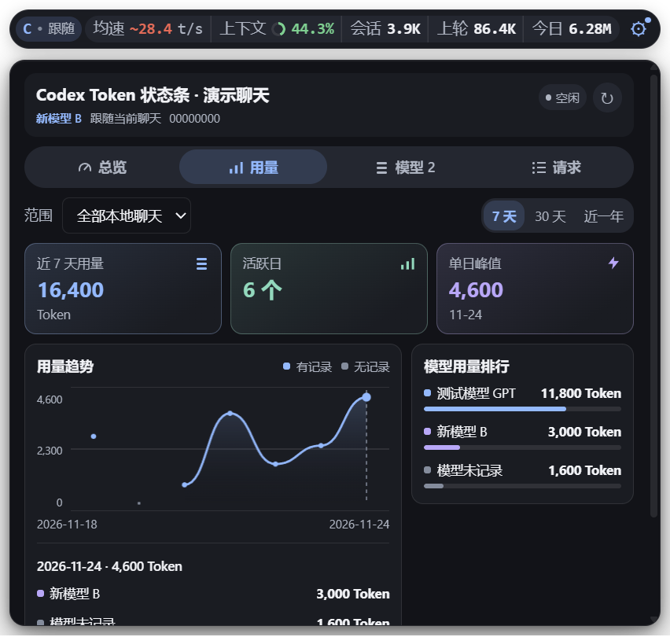
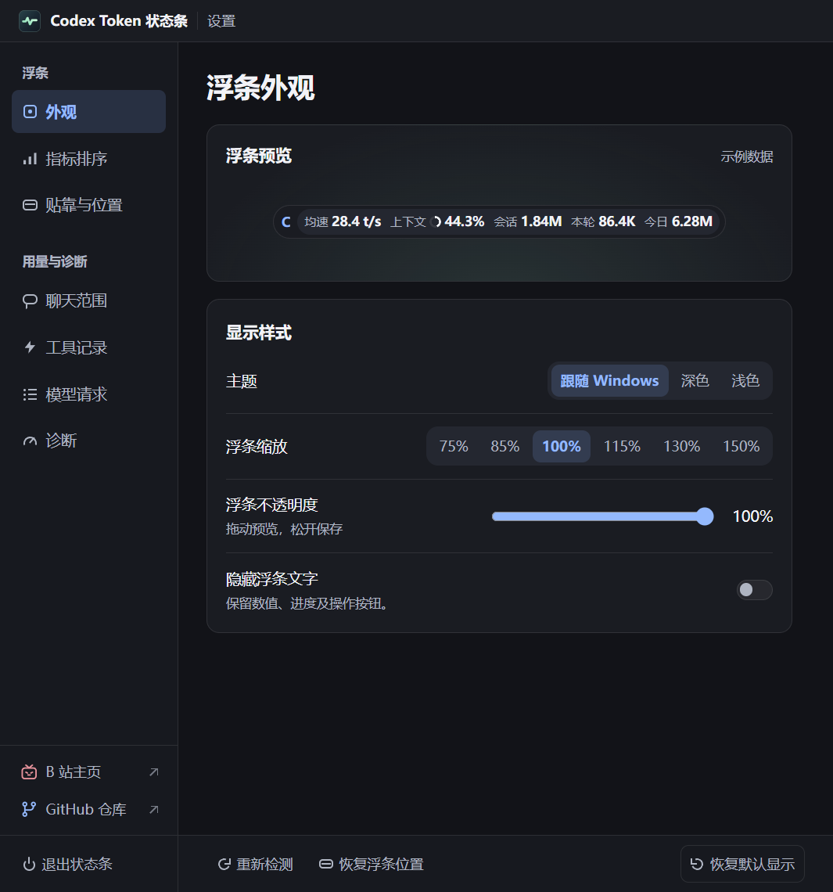

<h1 align="center">Codex Token 状态条</h1>

在 Codex 桌面版窗口上查看 Token 用量、上下文和账号额度。

<strong><a href="https://github.com/3ALLBUY14/codex-token-statusbar/releases/latest">下载 Windows x64 安装包</a></strong>

## 快速开始

1. 解压安装包，双击 **安装.cmd**，点击「安装并启动」。
2. 打开 Codex 桌面版并进入聊天。点击浮条的 <kbd>C</kbd> 查看明细，点击 <kbd>⚙</kbd> 打开设置。

便携使用可直接运行 app 目录里的 **CodexTokenStatusbar.exe**。

## 界面与功能

截图使用演示数据，点击可查看原图。

### 明细面板

| 分页 | 内容 |
| --- | --- |
| **总览** | 轮次均速、首 Token 延迟、会话累计、上下文构成、工具统计和官方额度。 |
| **用量** | 查看当前聊天或全部本地聊天的用量趋势、模型排行与热力图，可切换 7 天、30 天或近一年。 |
| **模型** | 查看当前与历史模型的 Token、缓存、推理用量和请求数。 |
| **请求** | 按轮次浏览模型请求，查看 Token、缓存率和耗时，支持按模型筛选。 |

额度显示已用、剩余和重置时间，每 5 分钟自动刷新，也可点击 **↻**。ChatGPT Pro 只显示周额度。

<strong>查看用量、模型和请求截图</strong>

  
  &emsp;
  

用量趋势 · 热力图

  
  &emsp;
  

模型用量 · 请求明细

### 设置

| 页面 | 操作 |
| --- | --- |
| **外观** | 预览浮条，调整主题、缩放和不透明度，或隐藏指标文字。 |
| **指标排序** | 勾选要显示的指标，通过拖动或上下按钮排序。 |
| **贴靠与位置** | 自由拖动浮条，或贴靠标题栏、输入框附近，可选居中、靠左或靠右。 |
| **聊天范围** | 自动跟随当前聊天，或搜索并锁定一个聊天。 |
| **工具记录** | 查看工具状态、耗时和失败记录，支持搜索、筛选和排序。 |
| **模型请求** | 按模型与日期筛选逐请求明细。 |
| **诊断** | 查看窗口跟随和连接状态，检查版本或开启更新提醒。 |

<strong>查看外观和工具记录截图</strong>

